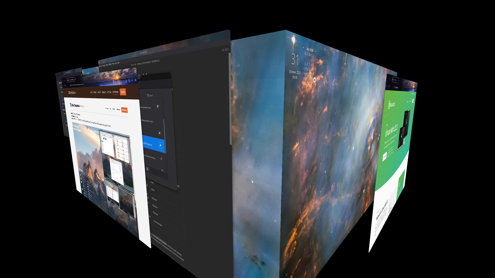

# Desktop Cube Reloaded

A Cinnamon extension that rotates your workspaces as the faces of a 3D cube. 

This is a port of Simon Schneegans' [Desktop Cube](https://github.com/Schneegans/Desktop-Cube) extension for GNOME Shell.

This Cinnamon port is called "Reloaded" because Cinnamon already has a simpler Desktop Cube extension.



Supports Cinnamon 6.0 and newer.

## Status

| Feature from the GNOME extension                              | Status                                                                                 |
| ------------------------------------------------------------- | -------------------------------------------------------------------------------------- |
| Cube rotation when switching workspaces                       | Done                                                                                   |
| Gap between last and first workspace                          | Done                                                                                   |
| Window parallax while rotating                                | Done                                                                                   |
| Rotating the cube by dragging a panel                         | Done                                                                                   |
| Zooming with the scroll wheel while dragging                  | Done (not in the GNOME version)                                                        |
| Rotating the cube by dragging the desktop                     | Open question: on X11 the desktop belongs to Nemo, so Cinnamon never sees those clicks |
| Vertical rotation and "exploding" windows                     | Done                                                                                   |
| Switching by pushing a dragged window against the screen edge | Planned                                                                                |
| Panorama (skybox) background                                  | Planned                                                                                |
| Per-monitor perspective correction                            | Planned                                                                                |
| Cube in Expo (GNOME's overview cube)                          | To be decided                                                                          |

## Usage

- Switch workspaces as usual (e.g. `Ctrl+Alt+Left/Right`) and the cube rotates.
- Press the left mouse button on an empty part of any panel and move the mouse: sideways
  rotates the cube, up and down tilts it, the scroll wheel zooms. Release to switch to
  the workspace facing you. The pointer is hidden during the drag, so screen edges don't
  get in the way.
- Turn off *Leave a gap between the last and first workspace* in the settings for a
  closed cube.

## How it works

GNOME Shell slides whole workspace groups during a switch, and the GNOME extension adds 3D
transforms to them. Cinnamon has no workspace groups: `WindowManager._switchWorkspace()`
slides each window by itself. This extension replaces that method on `Main.wm`. During a
switch it hides `global.window_group` and shows a scene of clones in its place: one cube per
monitor, with one face per workspace (wallpaper, desktop icons and windows). A
`Clutter.Timeline` turns the cube. When the timeline ends, the clones are destroyed, the real
windows come back and Muffin is told the switch is complete.

The cube geometry (face angle, pivot distance, depth sorting, parallax) comes from the
GNOME extension.

## Repository layout

The layout matches the [cinnamon-spices-extensions](https://github.com/linuxmint/cinnamon-spices-extensions)
repository, so the extension can be submitted there later:

```
Desktop-Cube-Reloaded@klangman/
  info.json
  files/Desktop-Cube-Reloaded@klangman/
    metadata.json          (multiversion)
    6.0/
      extension.js
      settings-schema.json
```

## Testing a development copy

Link the extension into your local extensions folder:

```sh
ln -s "$PWD/Desktop-Cube-Reloaded@klangman/files/Desktop-Cube-Reloaded@klangman" \
      ~/.local/share/cinnamon/extensions/
```

Then enable it in *System Settings → Extensions*. After changing the code, reload it with
the extension's reload button in Looking Glass (`Alt+F2`, `lg`, *Extensions* tab), or
restart Cinnamon (`Ctrl+Alt+Esc`). Errors show up in Looking Glass and in
`~/.xsession-errors`.

## License

GPL-3.0-or-later, like the original extension.
